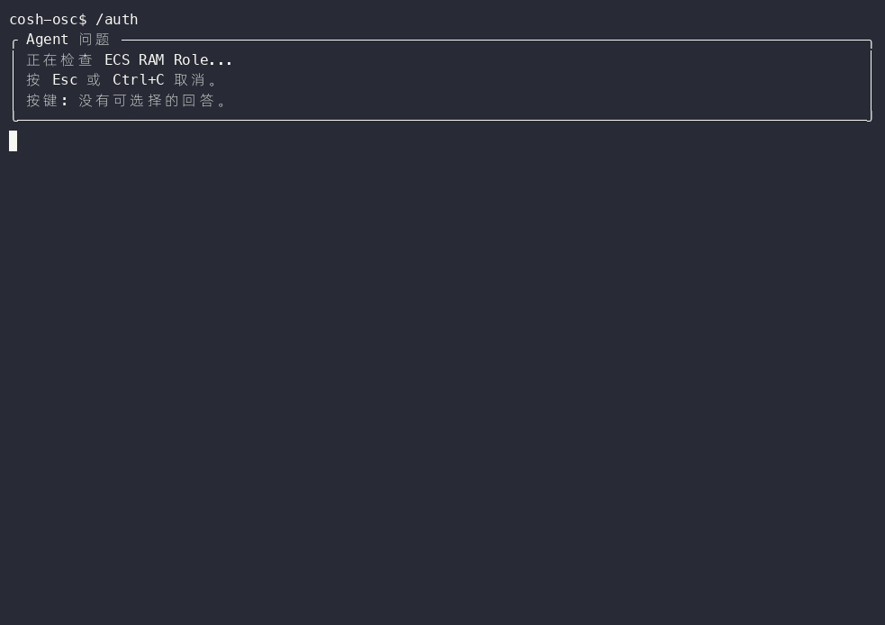
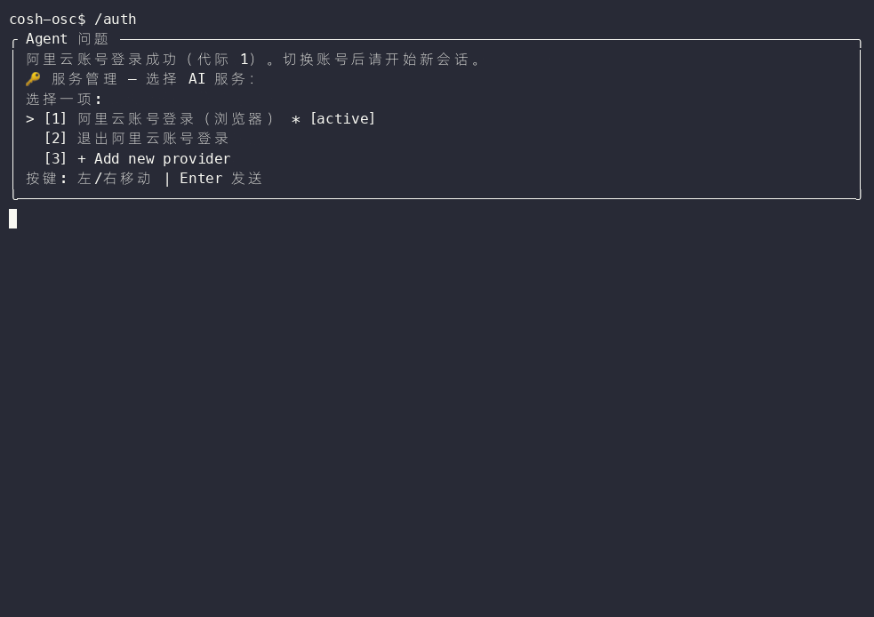
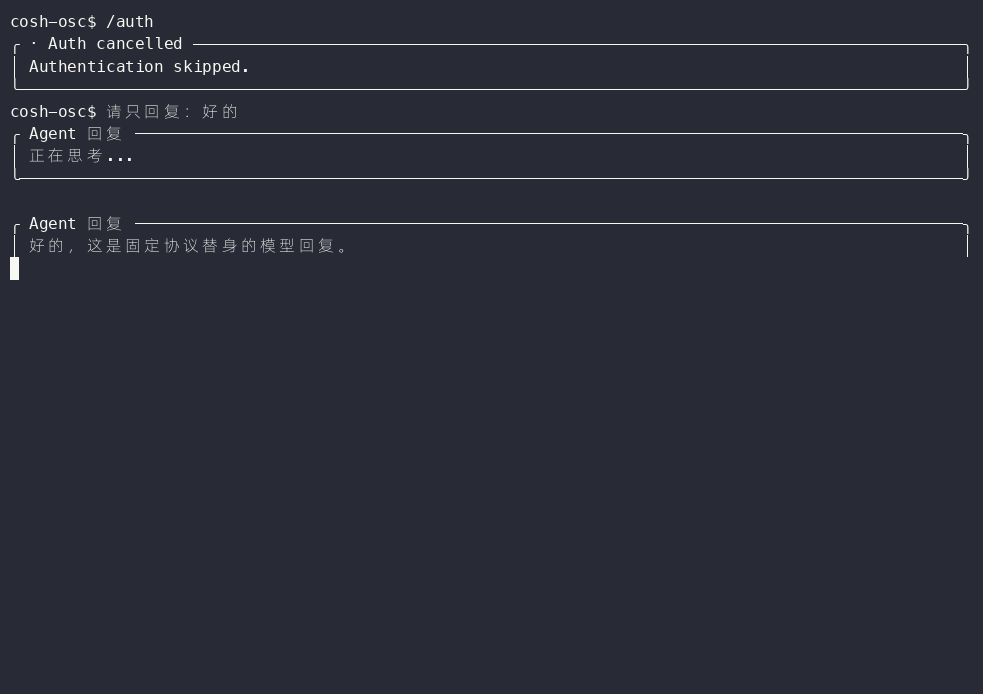
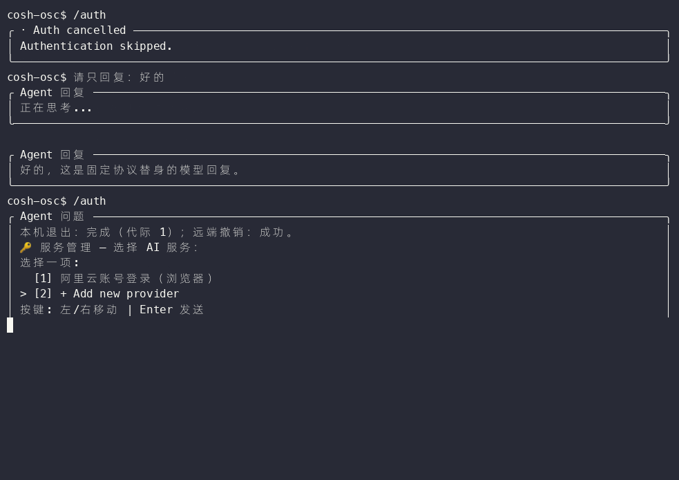
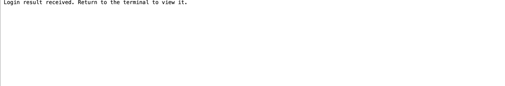

# PR #10637: OAuth flow evidence

These files are published on a dedicated evidence branch in the author's fork.
They are not part of the feature branch or product payload.

## Full container UI flow (protocol fixture)

This real Cosh shell recording covers `/auth`, selecting browser login,
waiting for authorization, login completion with an active source, a streamed
model reply, and logout with separate local and remote results.

**Scope:** the shell and its internal PTY run in the Linux container managed by
`cosh-dev`. Authentication and inference use an explicit fixed protocol fixture;
the recording is **not** evidence of live Alibaba Cloud OAuth or model access.
Only test-readiness control frames were removed before rendering. Output has
not been replaced with a mock screenshot. The recording keeps its real timing;
the final frame is held for readability.

| Milestone | Snapshot |
| --- | --- |
| Login completed, active source and logout option |  |
| Streamed fixture model reply |  |
| Local logout and remote revoke result |  |

## Real Chrome authorization return (separate live round)

This screenshot is from a **separate real pre-release browser login round**.
The already-authorized account returned directly to the loopback page, so it
shows the authorization return, **not an interactive consent screen**.
The browser address bar, callback parameters and unrelated browser notification
were excluded. No OAuth code, state, verifier, token or account details are
published.

## Provenance and validation

- Scene: `cosh-oauth-menu`; recipe: `cosh-ng-0.30-shell-core-debug-v1`.
- Source: see `provenance.json` for the feature commit and media fingerprints.
- Capture: actual Cosh raw shell inside the managed Linux container;
  fixed protocol fixture driver; `100 × 30` terminal viewport.
- Renderer: asciicast v2, `agg` at 16px, GIF optimization with `gifsicle`;
  PNG compression and browser screenshot resize with `ffmpeg`.
- Safety review: author-side rendered milestone inspection and
  `cosh-dev recording derive-publishable`; not independent human approval.
- Verification: login/wait/model/logout milestones present, capture exits 0;
  the UI-state preservation, status text and live logout-action dispatch have
  focused regression tests.
